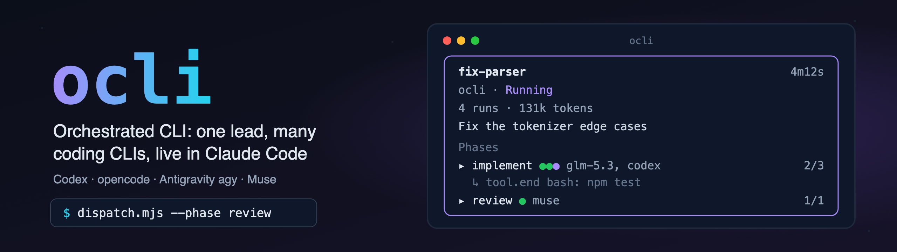
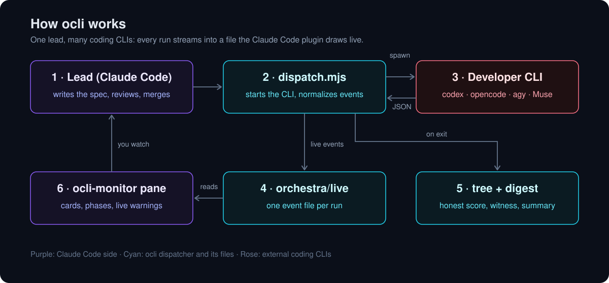

<p align="center">
  
</p>

<p align="center">
  
  
  <a href="LICENSE"></a>
  
  <a href="AGENTS.md"></a>
  
</p>

<p align="center">
  <code>claude-code</code> <code>claude-code-plugin</code> <code>codex</code> <code>opencode</code> <code>antigravity</code>
  <code>gemini</code> <code>muse</code> <code>coding-agents</code> <code>orchestration</code> <code>live-events</code>
</p>

# ocli — Orchestrated CLI

> **ocli (Orchestrated CLI):** run headless coding CLIs — Codex, opencode, Antigravity `agy`, Muse, Cline —
> under one lead and watch them live in Claude Code as Workflow-style cards.

**ocli** shows what your headless coding CLIs are doing while they do it. When Claude Code
orchestrates other agents (Codex, opencode, Antigravity `agy`, Muse, Cline) as background developers, each
one runs out of sight: you get a final message, or a stuck terminal, and nothing in between. ocli is
two small pieces: a **dispatcher** that runs one CLI per call and turns its native JSON event stream
into one normalized live-event file per run, and a **Claude Code plugin** that draws those runs as
Workflow-style cards with phases, status dots, token counts and the latest tool call, live.

## The card

```
╭──────────────────────────────────────────────────────────╮
│ ▸ fix-parser                                       4m12s │   press ▸ to open it in place; × once every run ended
│ ocli · Running                                           │   Running > Blocked > Failed > Stale > Completed
│ 4 runs · 131k tokens                                     │   input + output, summed over runs
│ Fix the tokenizer edge cases                             │   the newest run's --title
│ Phases                                                   │
│   implement  ●●●  glm-5.3, gpt-6-astra · 2/3 done        │   one dot per run, the LLMs, ended/total
│     ▁▁▂▃▁▅▇█▃▂ ↳ tool.end bash: npm test                 │   a running run's sparkline and last action
│   review  ●  muse-spark-1.3-contributor · 1/1 done       │
╰──────────────────────────────────────────────────────────╯
```

Under each phase, a running run keeps one line: its event-rate sparkline and its last action. Press
the card's head to open it in place: under each phase, one block per run says what the run was asked
(its brief: `--brief`, else the opening of `--prompt`), where it works, its tools and tokens, what
it is doing now (its live line and last tool calls), its latest message and warnings, and how it
ended (exit, score, `--verify`). Press again to close it. Cards are spaced apart, and a finished
card (completed, failed or blocked) gets an `×` that moves it to a **History** card at the bottom
(closed by default; open it to restore one); `Move completed to history` moves every Completed card
at once. Nothing moves to History by itself, a card with a running or stale run is never moved, and
History is kept per project across sessions. Ended runs raise one toast each; the status line reads
`ocli: N running`.

What else it does:

- **Declared phases.** `--declare-phases implement,review,merge` writes the task's plan before any run
  starts; the card draws every declared phase in order (pending ones dim) and counts `D/M phases`.
- **Honest scores.** `--verify` scores a run only when the CLI changed the work tree (file contents
  or `HEAD`): a green test suite on an untouched tree proves the base, not the developer.
- **Witness.** The CLI's closing claims ("all tests pass", "fixed", "committed abc1234") are checked
  against its own event trace. Unbacked claims show as `⚠ unwitnessed: …` on the run; they never
  change a score or status.
- **Night digest.** `/ocli-digest` (or `node dispatcher/digest.mjs`) summarizes the last 12 hours per
  task and phase: runs by status, scored passes against unscored runs, tokens, witness findings, and
  what needs a decision.
- **Heartbeat and loop warning.** A running run's live line leads with a 10-cell event-rate
  sparkline (30 s bins) and `xN` once one call repeats; eight identical calls with no
  success turn it warning-coloured, mark its phase row `⟳N`, and raise one "may be looping" toast.
  Nothing acts on the run.
- **Cache ratio and prefix drift.** A phase row shows `cache N%`: cache reads over all input read, for
  the runs that report both (unknown is never `0%`). Each dispatch records `prefixSha`, the first 12 hex
  of sha256 of its `--prompt` (never the `--suffix`); `⚠prefix×K` marks a phase whose runs on one CLI
  carry K > 1 distinct prefixes, so the cached prefix drifted.
- **Resume card** (optional). In a project that keeps dated checkpoint files, the first card shows the
  newest one's phase table, next action and resume command, with a `Queue resume` button.

## Requirements

- **Claude Code ≥ 2.1.292** (installing the plugin from a shell). The pane is a mod: mods need
  **≥ 2.1.287 in the terminal** and **≥ 2.1.286 in the Desktop app**.
- **Node.js ≥ 22** for the dispatcher and for `/ocli-digest`. No runtime dependencies.
- The developer CLIs you route to (`codex`, `opencode`, `agy`, `muse`), installed and logged in with
  their own login. ocli never handles their credentials.

## Quick start

**1. Install the plugin.** From a local clone (works before anything is published):

```sh
git clone <this repository> ocli
claude plugin marketplace add "$PWD/ocli"   # path to the clone; registers the marketplace "ocli"
claude plugin install ocli-monitor@ocli
```

or in one step: `claude plugin install ocli-monitor --marketplace "$PWD/ocli"`. Once the repository is
on GitHub, `claude plugin install ocli-monitor --marketplace nsozturk/ocli` does the same, and inside
a terminal session `/plugin install ocli-monitor@ocli` works after the marketplace is added.

**2. Make the dispatcher policy yours** (Node.js 22+, no dependencies; the dispatcher lives in the
clone, not in the installed plugin):

```sh
cp ocli/dispatcher/policy.example.json ocli/dispatcher/policy.json
```

This step is not optional in practice. The example routes pin the models they were verified with,
which your accounts may not have: set each route's `model` to one your CLI lists (`opencode models`,
`codex` model list, …), read [Permissions and sandboxing](#permissions-and-sandboxing), and dispatch
each route once by hand before you trust it. Without a `policy.json` the dispatcher uses the example.

**3. Keep the run files out of git.** The dispatcher writes full prompts, raw CLI transcripts and
stdout/stderr tails into your project; add these lines to the project's `.gitignore` first:

```gitignore
orchestra/
.orchestra-last.md
```

**4. Dispatch a run** from your project root, so the live files land where the pane looks:

```sh
node /path/to/ocli/dispatcher/dispatch.mjs \
  --role implement --task fix-parser \
  --phase implement --title "Fix the tokenizer edge cases" \
  --prompt "$(cat brief.md)" --verify "npm test"
```

To show the whole plan before the first run, declare the phases (this writes
`orchestra/live/<task>/plan.json` and spawns nothing):

```sh
node /path/to/ocli/dispatcher/dispatch.mjs --declare-phases implement,review,merge --task fix-parser
```

**5. Open the pane:** `/ocli`. It also opens itself at session start when the terminal is wide.
`/ocli-digest` opens the night digest in its own pane.

**6. Optional: the resume card.** If your project keeps dated checkpoint files,
`<project root>/checkpoints/YYYY-MM-DD_<slug>.md` with a Markdown table that has `Phase` and `Status`
columns (plus, optionally, a `## Next action` paragraph and a `## Resume` section whose first backtick
span is the resume command), the pane's first card shows the newest one. Without a `checkpoints/` dir
there is simply no card.

| flag | meaning |
|---|---|
| `--role` | a route in the policy (`implement` = opencode, `reason` = codex, `breadth` = agy, `muse` = Muse, `cline-*` = Cline), or `auto`: the highest-AA eligible route in `developers.rotation.order` (ties by rotation order; unranked routes are never auto-picked; none eligible = refuse; no CLI is spawned, though a usage read may have run) |
| `--min-aa` | with `--role auto`: only routes whose AA Intelligence Index is at least this |
| `--task` | groups runs into one card; `[A-Za-z0-9][A-Za-z0-9._-]*` |
| `--prompt` | the brief; passed as one argv element, never through a shell |
| `--phase` | the card phase this run belongs to (default: the role) |
| `--title` | what the run is for (default: the prompt's first line) |
| `--root` | the workspace the CLI works in (default: cwd) |
| `--verify` | a shell command run after the CLI; its exit code becomes `score` 1/0 |
| `--list-routes` | print every route ordered by its AA Intelligence Index (with eligibility); add `--json`; spawns nothing |
| `--pick-reason` | optional route-choice explanation recorded in the tree; cleaned like a pane label, capped at 200 code points |
| `--size` | `S`, `M` or `L`: the slice's size as the lead judged it, recorded on the tree node (`null` when omitted); anything else is refused |
| `--suffix` | per-run text appended last, so the shared prompt prefix stays cache-stable |
| `--parent` | the record id of the run this one continues |
| `--continue` | a node id: resume that failed or signalled run's WIP hand-off (see below); exclusive with `--worktree` |
| `--worktree` | `auto` only: run in `<repo>.worktrees/<task>` on branch `ocli/<task>`, created or reused (see below) |
| `--dry-run` | the last flag, with `--worktree auto` only: print the worktree path, create and spawn nothing |
| `--brief` | what the person reads in the pane's open card (default: the prompt's first heading and first task paragraph, then the `--suffix` without its worktree path; at most 600 code points). The pane shows the opening of `--prompt` unless `--brief` is given: keep secrets out of it. |
| `--declare-phases` | with `--task` only: write the task's plan (comma-separated phase names) and exit |

Exit codes: `0` the run was recorded (whatever the CLI's own exit code), `1` `--verify` failed,
`2` the dispatcher refused, could not start the CLI, or failed after it ran. A run that left the work
tree as it was (contents and `HEAD`) gets `score: null` even when `--verify` passes, whatever its exit
code: a green base says nothing about the developer.

**Provider window stops.** When a run fails (non-zero exit) and the CLI's *own* error or warn event says its plan window is
used up (ClinePass "5-hour Clinepass limit … resets in 1h 6m", ZAI "Usage limit reached for 5 hour … will reset at
2026-10-12 09:23:37"), the tree node records `providerStop: { provider, resetsAt, evidence }`. Every route on that billing
pool (all `cline-pass/*` routes share `cline`; opencode `zai-coding-plan/*` is `zai`) is then `excluded:budget-stop until …`
in `--list-routes` and skipped by `--role auto` until the reset, or until a later genuinely successful run of that pool.
An unparseable reset holds the stop until such a success. A transient 429 "rate limit" never stops a route, and limit
wording in model text never counts. An explicit `--role` to a stopped route still runs, with one warning line.

**Partial work: WIP hand-off.** When the CLI started and the run ends with a non-zero exit, `blocked`, a provider stop, or a
signal (Ctrl-C, `SIGTERM`, a closed terminal), whatever it left in `--root` becomes a commit `wip(<task>): <reason>` with a
trailer `Ocli-Handoff: <runId>`, and the tree node gains `handoff: { reason, branch, worktree, base, commit, commitSkipped,
changed, finalTextTail, … }` so the next developer starts from that work. It never commits on `main`, `master`, a remote's
HEAD branch or a detached HEAD, never bypasses hooks (a refusing hook is recorded and the tree stays dirty), and leaves
`orchestra/live`, `orchestra/tree`, `.orchestra-last.md` and `node_modules` out; any git failure lands in `commitSkipped`
(`clean-tree`, `default-branch`, `detached`, `not-git`, `hook-refused: …`, `timeout`), never in the dispatch's outcome. On a
signal the dispatcher stops the CLI (SIGKILL after 5 s), hands off within 10 s and appends a `partial: true` node before it
re-raises the signal. A successful run (exit 0, not blocked) adds no `handoff` field. Each node also records `size`, the
run's summed `tokens` (`metered` = input + output + reasoning; cached input is not metered; `null` when the CLI reports no
usage) and `usageDeltas`, one per usage window (5-hour and weekly apart).

**Resuming a hand-off: `--continue <nodeId>`.** Looks the node up in the tree and refuses, before anything is read or
spawned, an unknown id, a node without a `handoff`, a hand-off naming no worktree, or a `--root` other than that worktree.
Otherwise `--root` defaults to the hand-off worktree, `--parent` becomes the node, and one fixed note goes **after**
`--suffix` (so the prompt prefix and `prefixSha` are a fresh run's): the previous CLI/model, the stop reason, the WIP commit
and branch (a commit is used only if it is 7-64 lower-case hex; otherwise the note says "no commit" with `commitSkipped` and
points at `git status`), up to 20 changed lines, each value cleaned like a pane label and capped. `finalTextTail` is never
put in the note. The new node records `continuedFrom`.

**One worktree per task: `--worktree auto`.** The CLI runs in `<dirname(top)>/<basename(top)>.worktrees/<task>` on branch
`ocli/<task>`, where `top` is the git top of `--root` (or the cwd); the tree and live dirs stay where they were. A registered
worktree on that branch at that path is reused; an existing `ocli/<task>` branch is checked out as it is (never `-B`, its tip
is kept); otherwise the branch is created from `HEAD`. Anything else at the path (a foreign directory, a worktree on
another branch, a registered worktree whose directory is gone) is refused and left alone: the dispatcher never merges,
removes, prunes or forces. The task must be a safe path segment (no `/`, no `..`), every git call runs with
`core.fsmonitor=false`, and the worktree is created only after the route is validated, so an unknown `--role` leaves nothing
behind. `--dry-run` (as the last flag) prints the path and returns before any read or spawn.

## Configuration

ocli reads no credentials, no keychain and no account file. Everything machine-specific is optional
and set by you:

| setting | where | default |
|---|---|---|
| `ORCHESTRA_LIVE_DIR` | environment, for `dispatch.mjs` and `digest.mjs` | `<cwd>/orchestra/live` |
| `liveDirs` | plugin option (`/config`, or `claude plugin install … --config liveDirs=<dirs>`) | `<project root>/orchestra/live` |
| routes and models | `dispatcher/policy.json` (gitignored; copy of `policy.example.json`) | the example routes |
| `ORCHESTRA_POLICY` | environment: path to a policy file used instead of both of the above | unset |
| `ORCHESTRA_PLANS` | environment: path to your provider plans (see below) | `~/.config/agent-rules/provider-plans.json`, else `dispatcher/provider-plans.example.json` |

```sh
export ORCHESTRA_LIVE_DIR=/absolute/path/to/orchestra/live   # optional
```

[`.env.example`](.env.example) lists the same variable; the scripts do not load it, export it in your
shell. If you move the live dir, point the plugin's `liveDirs` at the same absolute path.

**Usage counters are optional.** `dispatcher/usage.mjs` asks codex for its rate limits by spawning
`codex app-server` (from `PATH`) and calling `account/rateLimits/read` over stdio, using codex's own
login; it reads no file. Claude Code's limits come only from a snapshot the lead passes in, and
GLM (opencode) has no readable quota source. Whatever cannot be read is reported as `unknown`, and
a capped route with an unknown reading is not dispatched on an assumption.

**Provider plans set the caps.** What each subscription allows lives in one strict JSON file (schema
v1, `dispatcher/plans.mjs`), read from `ORCHESTRA_PLANS`, else `~/.config/agent-rules/provider-plans.json`,
else the shipped [`dispatcher/provider-plans.example.json`](dispatcher/provider-plans.example.json) (with
one stderr warning per process). A counter pool whose `onUnknown` is `refuse` stops at
`100 − reservePercent` on its `limitIds` (codex in the example: 95%), on **every** window it reports,
weekly as well as 5-hour; every other pool (`until-stop`, claude included for now) runs until the
provider itself stops it. A file that exists but fails to parse, or is a symlink, is an error, never a
fall-through: every capped route then gates `unknown`. A recorded reading whose window has since reset
is `tree-expired` (unknown, not room); `--role auto` re-reads such a capped route once (a usage read,
never an inference call) before it picks, and `--list-routes` never reads.

## Permissions and sandboxing

A headless CLI cannot answer a permission prompt, so the example routes pass each CLI's own
no-prompt flags. **Only the codex routes run inside a sandbox.** A git worktree (`--root`) is where a
CLI works, not a security boundary: an agent without approvals and without a sandbox can read and
write anything your user can, use the network, and push with your git credentials.

| route | CLI | approval | OS sandbox | shipped status |
|---|---|---|---|---|
| `reason`, `easy` | codex | n/a (`exec`) | yes: `-s workspace-write` confines writes to `{root}` | `ok` / `unverified` |
| `implement` | opencode | off: `--auto` approves everything | none | `ok` |
| `muse` | Muse | off: `--disable-approval`, `--user-input-auto-resolve` | Muse's own, unless a wrapper injects `--yolo` | `ok` |
| `breadth` | agy | off: `--dangerously-skip-permissions` | none, and not confined to `{root}` | `unverified` |
| `cline-mimo`, `cline-qwen` | Cline (Cline Pass) | off: act mode auto-approve | none; `-c {root}` sets the workspace | `ok` |

Run the unsandboxed routes only where that is acceptable: a disposable VM or container, or a
dedicated user account without your credentials. `breadth` ships `unverified` for that reason; the
dispatcher refuses it until you set `"status": "ok"` in your own `policy.json`.

## What it runs and reads

The plugin (`ocli-monitor`) is everything Claude Code installs; this is all it does at run time.

**Processes it spawns:** one, only when you type `/ocli-digest`:
`node <plugin root>/lib/digest.mjs --root <project root>/orchestra`, through `$.process.run` with a
20 s timeout. The script is the plugin's own copy (byte-identical to `dispatcher/digest.mjs`, checked
by a test), never a script from your project. It reads `<project root>/orchestra/tree` and the live dir and
writes nothing.

**Paths it reads** (`$.fs.list`, `$.fs.stat`, `$.fs.read`):

- the live dirs: each `liveDirs` entry, else `<project root>/orchestra/live`, and the
  `<task>/<runId>.jsonl` files in them (never `*.raw.jsonl`); at most 500 files per tick, none over
  4 MiB;
- `<task>/plan.json` in a live dir: at most 64 KiB, dated within a day;
- `<project root>/checkpoints/YYYY-MM-DD_*.md`: plain names only, at most 256 KiB, the ten newest;
- this session's subagent list (`$.agent.list`), for the "Claude subagents" card.

Every file is read only when its resolved `realPath` lies under the resolved dir it was listed from;
symlinks are skipped, the path is resolved again after the read, and the text is dropped if it moved.
The project root is `$.session.root`; on some builds `$.session.root` is unavailable, and the plugin
falls back to the session cwd.

**Never:** no network access, no writes anywhere except its own `$.state` (expanded rows, announced
runs; the digest pane's `Copy` button puts the digest on the clipboard), and no prompt submitted on
its own. `$.prompt.submit` runs only when you press
`Queue resume`, and only with one fixed sentence naming the checkpoint file.

The bundled scripts live in `plugin/lib/`, not `bin/`, so installing the plugin adds nothing to the
Bash tool's `PATH`.

## How it works

<p align="center">
  
</p>

The path of one dispatch:

1. **The lead hands out a slice.** You, or Claude Code acting as lead, run
   `node dispatcher/dispatch.mjs --role implement --task slice-052 --phase Develop --title "…" --root ../worktree --prompt "…"`.
   Optionally `--declare-phases spec,develop,review,merge` first, so the card shows the whole plan
   (`0/4 phases`) before anything runs.
2. **The dispatcher starts the CLI.** It picks the route from `policy.json` (codex, opencode/GLM,
   agy or Muse), starts the CLI in its own JSON event mode with argument arrays and stdin closed,
   and pins its workspace (`--dir` for opencode, `--add-dir` for agy).
3. **Every event streams into a file as it happens.** Each line the CLI prints is normalized into the
   shared contract (start, tool start/end, message, tokens, warning, end) and appended to
   `orchestra/live/<task>/<runId>.jsonl`; the raw line goes beside it in `.raw.jsonl`. Both are
   owner-only (0600) and stay out of git.
4. **When the CLI exits, the result is judged, not trusted.** The verifier runs, and the
   finished-run record goes to `orchestra/tree/`:
   - a CLI that failed, never started, or left the tree untouched is never scored as passed (`null`, not `1`);
   - the witness checks the CLI's closing claims ("tests pass", "committed …") against its own trace;
   - a quota stop is labelled by what actually confirmed it;
   - Ctrl-C, a kill or a closed terminal still closes the run with `run.end`.
5. **The pane draws it.** The `ocli-monitor` plugin reads the live dir every 2 s and draws one
   Workflow-style card per task: status, the LLMs that have the work, coloured phase dots, the live
   latest event, a loop warning, unwitnessed-claim warnings and a resume card from your newest
   checkpoint. Untrusted CLI text is stripped of ANSI, control and bidi characters before it is drawn.
6. **The digest sums it up.** `/ocli-digest` (or `node dispatcher/digest.mjs`) summarises the last
   12 hours per task and phase, with unscored runs listed apart and never counted as failures.

<details>
<summary>The same data flow, in text</summary>

```
 Claude Code (lead)                                  Claude Code (pane)
        │                                                    ▲
        │ node dispatcher/dispatch.mjs --role … --phase …    │ ocli-monitor plugin
        ▼                                                    │ polls every 2 s, folds by (task, runId, seq)
 ┌──────────────┐  argv, stdin closed  ┌──────────────┐      │
 │ dispatch.mjs │ ───────────────────▶ │  codex exec  │      │
 │              │ ◀─── JSON lines ──── │  opencode run│      │
 │  events.mjs  │      on stdout       │  agy / muse  │      │
 │  normalize() │                      └──────────────┘      │
 └──────┬───────┘                                            │
        │ append, 0600                                       │
        ├──▶ orchestra/live/<task>/<runId>.jsonl  ───────────┘   normalized events (v1)
        ├──▶ orchestra/live/<task>/<runId>.raw.jsonl             every raw line, for evidence
        └──▶ orchestra/tree/<task>.jsonl                         one record per finished run
```

</details>

- **One file per run.** Concurrent runs of the same task never share a file; `seq` is contiguous
  and `run.end` is written exactly once, also on Ctrl-C, `SIGTERM` or a closed terminal.
- **Quota claims are checked.** A transcript that merely quotes "rate limit" is not a refusal.
  When the provider exposes a usage counter (codex), the dispatcher reads it before and after the
  run and marks the run `blocked` only when the counter or the CLI's own error event confirms it.
- **Unknown stays unknown.** No verifier means `score: null`, no token report means `null`, never 0.
- **Claims are witnessed, not trusted.** `witness.mjs` compares the CLI's final message with its
  own `tool.end` trace (edits, test runs, commits) and records findings such as `staleGreen` or
  `doneNoChange` on the tree record and on `run.end`.
- **Untrusted text is defused.** Titles, phases and every string the pane draws have ANSI escapes,
  control and bidi characters stripped; only contract fields are read; symlinks and files over
  4 MiB are skipped.

The full contract, including how another dispatcher can write compatible files, is in
[`docs/LIVE-EVENTS.md`](docs/LIVE-EVENTS.md).

## Repository layout

| path | what |
|---|---|
| `.claude-plugin/marketplace.json` | marketplace listing the `ocli-monitor` plugin |
| `plugin/` | the Claude Code plugin (pane, hooks, types, its own tests) |
| `plugin/lib/` | `digest.mjs` and `pane-label.mjs`, byte-identical copies of the dispatcher's, so the installed plugin is self-contained |
| `tools/gen-fixtures.mjs` | regenerates `plugin/hooks/fixtures.ts` from the captures in `tests/fixtures/` |
| `dispatcher/` | `dispatch.mjs`, `events.mjs` (normalizer), `witness.mjs` (claims vs trace), `digest.mjs` (night digest), `usage.mjs` (codex usage reader), `handoff.mjs` (WIP hand-off), `worktree.mjs` (`--worktree auto`), `plans.mjs` + `provider-plans.example.json` (caps), `quota.mjs` (pure headroom + `decide` run/split/wait, not wired yet), `policy.example.json` |
| `docs/LIVE-EVENTS.md` | the normalized live-event contract |
| `tests/` | dispatcher, normalizer, witness and digest tests (vitest), with one real capture per CLI |

## Tests

```sh
npm install && npm test              # dispatcher + normalizer (vitest is the only devDependency)
claude plugin test plugin            # the plugin's own tests, in Claude Code's plugin test runner
claude plugin validate .             # the marketplace manifest only
claude plugin validate plugin        # the plugin manifest, types and hooks
```

## Limitations

- **`$.ui.notify` and `$.session.root`.** On some builds (2.1.294, the version this was tested on,
  among them) `$.session.root` is unavailable; the plugin falls back to the session cwd for the
  default live dir and the checkpoints. Where `$.ui.notify` is missing, a blocked run lands as a
  toast instead of a system notification.
- **Desktop app:** the pane is a terminal mod surface. In the desktop app it appears only after the
  plugin was installed from a terminal session (or loaded with `CLAUDE_CODE_PLUGIN_DIRS`), and where
  no terminal is bound, toasts are not sent.
- **Error shapes are partly source-derived.** Successful runs of all four CLIs are captured in
  `tests/fixtures/`. Codex `turn.failed`, opencode `error`, agy non-`SUCCESS` results and Muse
  terminal events other than `completed` are mapped from the CLIs' sources, not from captures.
- **Usage counters:** only codex exposes one locally. For opencode, agy and Muse a quota refusal is
  recognized from the CLI's own error event or from stderr on a failed run, and the record says the
  verdict is unconfirmed.
- **`/ocli-digest` needs Node.js on `PATH`.** It runs `node <plugin root>/lib/digest.mjs`; without
  `node`, or where the runtime has no `$.process`, it answers `ocli digest unavailable: <reason>`.
- **CLI flags drift.** The argv in `policy.example.json` is what each CLI accepted when it was
  verified; re-probe a route after upgrading a CLI.

## License

[MIT](LICENSE) © 2026 Enes Öztürk
